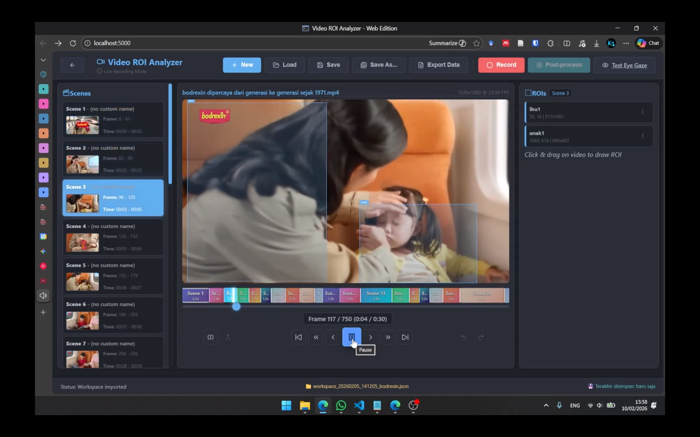

# SOROT

**S**timulus **O**riented **R**egion-**o**f-interest **T**ool is a web application for academic and laboratory eye-tracking studies on video advertisements and other stimuli.

Started as my Bachelor’s thesis at ITS, this computer-vision extraction of x/y gaze points from screen-recorded eye-tracking sessions is being extended after graduation with ROI analysis, live capture, and reporting, following ideas from Prof. Adhi Dharma Wibawa.

I designed the system, the implementation were AI-assisted, and all the outputs were reviewed by me. The primary interface is a **Vue 3 + Vite + TypeScript** single-page app (`frontend/`) talking to a **Flask + Socket.IO** API (`sorot.py`). Define scenes and ROIs, import or record gaze data, and export metrics for neuromarketing and vision research.

[](https://youtu.be/gYU284DnV2E?si=Czivn9iUYMuccNYK)

<p align="center"><i>(Click the screenshot to play the video; It still showing the old version of the project, pls try it to get the latest one)</i></p>

## Branches

| Branch | Purpose |
|--------|---------|
| **`main`** | Stable, release-ready code |
| **`dev`** | Active development; open pull requests here |

```bash
git clone https://github.com/kahlilzulmi/sorot.git
cd sorot
git checkout dev   # latest work in progress
```

See [CONTRIBUTING.md](CONTRIBUTING.md) for the full workflow.

## Features

- HTML5 video playback with frame-accurate scene boundaries
- Interactive ROI editor (position, size, labels, colors)
- Real-time gaze capture over WebSocket (live recording mode)
- Gaze CSV import and client-side extraction (Web Worker)
- Post-processing: fixations, ROI dwell time, validation overlays
- PDF/Excel report generation
- Optional OBS Studio control and YouTube stimulus download
- Workspace save/load (JSON projects)

## Quick start with Docker

The fastest way to run SOROT with the production Vue UI (no local Node.js required):

```bash
git clone https://github.com/kahlilzulmi/sorot.git
cd sorot
git checkout main   # or dev for the latest integration branch
docker compose up --build
```

Open **http://localhost:5000**

Set a real secret for anything beyond localhost:

```bash
FLASK_SECRET_KEY=your-long-random-string docker compose up --build
```

Data (videos, sessions, workspaces) is stored in Docker volumes and persists across restarts.

Plain Docker:

```bash
docker build -t sorot .
docker run --rm -p 5000:5000 -e FLASK_SECRET_KEY=change-me sorot
```

## Development (Vue + Flask)

### Requirements

- Python 3.10+
- Node.js 18+

### Install

```bash
pip install -r requirements.txt
cd frontend && npm install && cd ..
```

Copy `.env.example` to `.env` and set `FLASK_SECRET_KEY` when needed.

### Run

```powershell
.\dev.ps1
```

| Service | URL |
|---------|-----|
| **Vue UI (use this)** | http://localhost:5173 |
| Flask API / Socket.IO | http://127.0.0.1:5000 |

Vite proxies API and WebSocket traffic to Flask.

### Production-style local run (single port)

Build the frontend and serve it from Flask on port 5000:

```bash
cd frontend && npm run build && cd ..
python sorot.py
```

Open **http://localhost:5000**

### Verify installation

```bash
python tests/test_setup.py
```

## Repository layout

```
sorot/
├── sorot.py                 # Flask + Socket.IO API
├── frontend/                # Vue 3 + Vite UI (primary)
├── static/dist/             # Production build output (gitignored; created by npm run build)
├── legacy/                  # Archived CDN-Vue UI (see legacy/README.md)
├── gaze_post_processor.py   # Gaze analysis pipeline
├── report_generator.py      # PDF / Excel reports
├── tests/                   # Setup and integration tests
├── docs/                    # Architecture and deployment guides
└── projects/                # Workspace JSON (runtime; see example.workspace.json)
```

Runtime directories (`uploaded_videos/`, `sessions/`, etc.) are created automatically and are gitignored.

## Legacy UI (archived)

The pre-Vite editor is **archived** under `legacy/_archived/` (not deleted). **`/legacy/` redirects to `/`**.

| URL | Purpose |
|-----|---------|
| `/` | Primary Vue 3 editor |
| `/settings` | OBS/diagnostics configuration (Vue) |
| `/legacy/settings` | Redirects to `/settings` |
| `/legacy/test-gaze` | Legacy ROI/gaze test page |

Do not add features under `legacy/`; use `frontend/` only.

## Documentation

- [Contributing](CONTRIBUTING.md)
- [Architecture](docs/architecture.md)
- [Development](docs/development.md)
- [Socket.IO production](docs/socketio-production.md)

## Research use

SOROT is intended for **educational and laboratory research** only. When publishing results, cite the tool and document your ROI definitions, gaze hardware, and sampling rate. Do not commit participant recordings or identifiable data to this repository.

Automating or analyzing commercial eye-tracking overlays (including Tobii Ghost) may conflict with vendor EULAs — you are responsible for compliance. See [NOTICE](NOTICE) for trademark disclaimers, third-party licenses, and algorithm attributions.

## License

[MIT](LICENSE) — third-party notices and disclaimers in [NOTICE](NOTICE).

## Acknowledgments

Developed for academic laboratory video ROI and gaze analysis. Contributions welcome via [CONTRIBUTING.md](CONTRIBUTING.md).
